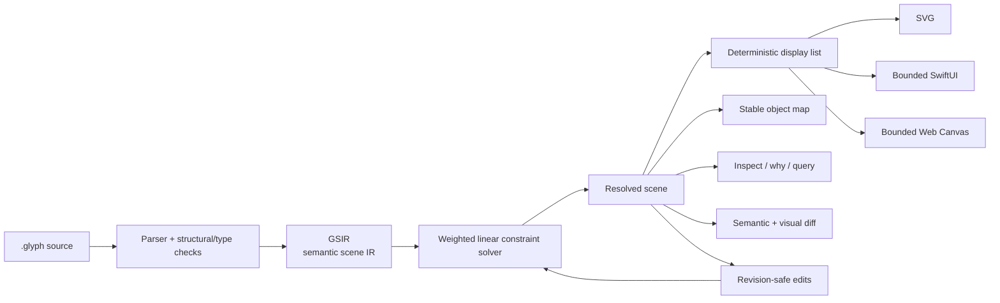

# Glyph — The Design Language Built for AI Agents

**AI can generate pixels. Glyph gives it a design system it can actually understand.**


> **The bet:** pixel-first design files become the assembly language of AI-native design.
>
> The next serious design runtime for agents should not begin with a screenshot and hope the model remembers what every rectangle meant. It should begin with identity, intent, constraints, provenance and semantics — then produce pixels.

Glyph is an experimental **semantic visual language, intermediate representation, constraint compiler and design runtime**. A Glyph scene can be read by a human, manipulated by an agent, solved deterministically, diffed by stable object identity, and lowered into multiple visual or semantic targets without throwing away the structure that made the design editable in the first place.

This repository is the working v0.1.0 implementation.

---

## Why this exists

Today's AI design loop is usually backwards:

```text
prompt → pixels → screenshot → vision model → guess the structure → rewrite everything
```

That loop is impressive, but structurally weak. Once a design becomes pixels, an agent has to rediscover things the system already knew:

- which object is the primary CTA;
- which two elements are intentionally aligned;
- whether a coordinate was authored or derived;
- which constraint is allowed to move;
- what changed between revisions;
- whether an export preserved semantics or merely looked similar;
- whether a node is safe to edit without collateral damage.

Glyph keeps that information alive.

```text
intent → .glyph source → GSIR → constraints → resolved scene
                                  ↓
                       display list + object map
                                  ↓
              render / inspect / diff / edit / export
```

The result is not "AI that draws harder." It is a design representation an agent can reason about.

## A design file with memory

```glyph
scene "Sakura Lake" @id("scene_sakura_lake") {
  canvas 1290 2796 background "#DDEFF1";

  rect sky @id("sky") {
    role "background" "sky";
    x 0;
    y 0;
    width 1290;
    height 2796;
    fill "#DDEFF1";
  }

  path mountains @id("mountains_mid") {
    role "mountain" "landform" "midground";
    d "M0 1060 C180 810 340 920 510 720 C670 900 810 770 960 930 C1090 800 1200 880 1290 820 L1290 1550 L0 1550 Z";
    fill "#AFC8C4";
  }

  ellipse lake @id("lake") {
    role "lake" "water" "midground";
    cx 645;
    cy 1660;
    rx 520;
    ry 270;
    fill "#72B6C8";
  }

  rect bridge @id("bridge") {
    role "bridge" "architecture" "focal-support";
    x 430;
    y 1590;
    width 430;
    height 56;
    rx 28;
    fill "#C58C68";
  }

  ellipse mascot @id("mascot") {
    role "mascot" "primary-focal";
    cx 645;
    cy 1390;
    rx 92;
    ry 108;
    fill "#3E5558";
  }

  ellipse tree_left @id("tree_left") {
    role "tree" "foreground" "framing";
    cx 195;
    cy 2080;
    rx 185;
    ry 310;
    fill "#EAA6B2";
  }

  ellipse tree_right @id("tree_right") {
    role "tree" "foreground" "framing";
    cx 1090;
    cy 2110;
    rx 150;
    ry 265;
    fill "#F3C1C9";
  }

  path foreground @id("foreground") {
    role "vegetation" "foreground";
    d "M0 2200 C220 2100 370 2290 560 2180 C760 2070 910 2250 1080 2150 C1180 2090 1240 2110 1290 2080 L1290 2796 L0 2796 Z";
    fill "#688E70";
  }

  text title @id("title") {
    role "heading" "primary-text";
    content "Give the next few months a shape.";
    x 645;
    y 220;
    size 58;
    font "New York";
    weight "600";
    align "center";
    fill "#293538";
  }

  constrain title.center_x == canvas.center_x @required;
  constrain mascot.center_x == canvas.center_x @required;
  constrain bridge.center_x == lake.center_x @strong;
  constrain bridge.center_y == lake.center_y - 70 @strong;
  constrain tree_left.right <= mascot.left - 40 @strong;
  constrain tree_right.left >= mascot.right + 40 @strong;
}
```

That scene expresses more than a flattened bitmap: the scene has a stable identity, the lake has a semantic role, and its horizontal position is governed by an explicit required relationship rather than a coincidental coordinate.

Change the canvas. Re-solve the scene. Ask why the lake moved. Diff the result by object ID. The intent survives.

## What makes Glyph different

| Primitive | Why it matters for agents |
| --- | --- |
| **Stable semantic IDs** | An agent can address the same object across edits instead of rediscovering it spatially. |
| **Authored vs. derived state** | Glyph distinguishes what the designer chose from what the solver computed. |
| **Typed constraints** | Relationships are explicit and machine-editable instead of implied by nearby coordinates. |
| **Provenance** | Source-backed values can retain where they came from and how confidently they were inferred. |
| **Semantic roles + accessibility metadata** | Meaning can travel through the runtime rather than being reconstructed after rendering. |
| **Revision-safe transactions** | Mutations can reject stale base revisions instead of silently editing the wrong state. |
| **Semantic + visual diffs** | Changes are described by stable objects, movement, geometry, style and content — not only line noise. |
| **Deterministic artifacts** | Repeated compilation/render paths are designed to be inspectable and reproducible. |
| **Fail-closed target conformance** | Unsupported target semantics are reported instead of being silently guessed or flattened. |
| **Source-authoritative round trip** | Direct manipulation can map back to authored source when the inverse edit is unambiguous. |

## Architecture



The separation is deliberate:

1. **`.glyph` is the authored human/agent layer.**
2. **GSIR is the canonical semantic representation.**
3. **The solver produces resolved geometry without erasing authored intent.**
4. **Display-list and object-map layers provide backend-neutral rendering and inspection contracts.**
5. **Targets declare what they can preserve.** Unsupported semantics fail closed rather than pretending to be exact.

See [`docs/ARCHITECTURE.md`](docs/ARCHITECTURE.md) for the deeper model.

## The agent loop

A normal Glyph workflow is closer to operating a structured system than repainting a screenshot:

```text
query role
   ↓
inspect / why
   ↓
plan a source-backed or revision-safe edit
   ↓
solve constraints
   ↓
semantic diff + visual diff
   ↓
render / export
   ↓
verify
```

The runtime already exposes machinery for:

- querying by semantic role;
- inspecting authored and derived values;
- explaining why a node resolved where it did;
- listing and editing typed constraints;
- revision-safe GSIR transactions;
- source-backed property edits;
- direct drag and resize planning/application where inversion is unambiguous;
- hierarchy reparenting and layer reordering;
- typed components and instances;
- semantic and resolved visual diffs;
- deterministic display lists and object maps;
- accessibility and renderer-conformance reports;
- bounded semantic code generation.

If the requested edit cannot be mapped back safely, Glyph is designed to **fail closed** rather than invent intent.

## Quick start

### Build

```bash
git clone https://github.com/yashkhou/glyph.git
cd glyph
cargo build --release
```

The CLI will be at:

```bash
./target/release/glyph
```

### Check and compile a scene

```bash
./target/release/glyph check examples/sakura_lake.glyph
./target/release/glyph compile examples/sakura_lake.glyph \
  --output /tmp/sakura_lake.gsir.json
```

### Query the semantic scene

```bash
./target/release/glyph query /tmp/sakura_lake.gsir.json --role lake
./target/release/glyph inspect /tmp/sakura_lake.gsir.json lake
./target/release/glyph why /tmp/sakura_lake.gsir.json lake
```

### Render SVG

```bash
./target/release/glyph render /tmp/sakura_lake.gsir.json \
  --output /tmp/sakura_lake.svg
```

### Ask what each target can preserve

```bash
./target/release/glyph targets examples/sakura_lake.glyph
./target/release/glyph conformance examples/sakura_lake.glyph
```

### Generate native target code — only when the scene fits the supported subset

```bash
./target/release/glyph export-swiftui scene.glyph --output GlyphSceneView.swift
./target/release/glyph export-web-canvas scene.glyph --output scene.mjs
```

See [`docs/CODEGEN.md`](docs/CODEGEN.md) for the exact semantic-codegen contract.

## Outputs and targets

Glyph deliberately separates **visual export** from **semantic code generation**.

| Target | Role | Current contract |
| --- | --- | --- |
| **GSIR JSON** | Canonical machine representation | Stable semantic scene data, constraints, provenance and revisions. |
| **Display list JSON** | Backend-neutral resolved primitives | Deterministic resolved drawing contract with stable IDs. |
| **Object map JSON** | Inspection/selection bridge | Stable IDs mapped to display index, kind, roles, bounds and provenance. |
| **SVG** | Visual/vector export | Deterministic visual output with stable-ID and semantic-role metadata where supported. |
| **SwiftUI** | Semantic codegen | **Bounded subset.** Unsupported semantics return reasons rather than guessed code. |
| **Web Canvas** | Semantic codegen | **Bounded subset.** Emits an ES module plus stable object-map behavior for supported scenes. |

A target being able to *draw* something is not the same as preserving its semantics. Glyph reports that distinction explicitly through target strategy and conformance data.

## Constraints are part of the design

Glyph uses a Cassowary-class weighted linear constraint solver with relations:

```text
==   >=   <=
```

and strengths:

```text
required   strong   medium   weak
```

A relationship such as:

```glyph
constrain mascot.center_x == canvas.center_x @required;
```

is not a comment. It is executable design intent.

That gives an agent a safer question to answer than "what x-coordinate looks right?" It can ask: **what relationship owns this position, and what is the smallest valid edit?**

## Source-authoritative direct manipulation

Glyph Studio and the source-editing runtime are built around a hard rule: the authored source remains authoritative.

For supported operations, drag/resize/reparent/reorder actions can be planned against the semantic graph and written back to source. Glyph can edit a free authored coordinate, adjust a single equality relation, transform supported path placement, or invert a typed component parameter when there is one unambiguous owner.

When there are multiple plausible owners, generated-only state, or an unsupported inverse mapping, the operation is blocked instead of mutating unrelated source.

## Components, instances and reusable intent

Glyph includes typed components and instances rather than treating reuse as copy/paste geometry. Component parameters, variants and instance values can participate in source-backed editing and manipulation.

See [`docs/COMPONENTS.md`](docs/COMPONENTS.md).

## Accessibility is not an afterthought

Accessibility metadata lives in the semantic scene and lowers through the runtime. The current system can carry roles/labels through the display list and compatible outputs, including SVG ARIA metadata, and can produce a deterministic accessibility audit.

This matters because an agent should not have to infer accessibility semantics from the final pixels after the fact.

## Language tooling

Glyph includes language-service infrastructure for editor-grade workflows, including diagnostics, completion, definition/references, hover, semantic tokens and rename behavior over the supported source model.

The long-term goal is straightforward: editing a design language should feel as inspectable as editing a programming language.

## Native Glyph Studio

The repository contains an experimental native macOS **Glyph Studio v0.1** built in SwiftUI.

The current Studio path is focused on proving the round trip between source, resolved semantic state and direct manipulation. It includes source/resolved views, semantic inspection, selection, drag/resize flows, constraint visibility, history/undo-redo, hierarchy operations and component-aware editing over the supported subset.

Studio is not presented as a finished commercial design application. It is the visual workbench for the runtime.

## Project bundles and assets

Glyph project tooling can verify project structure and asset manifests, including SHA-256-backed project assets and deterministic bundle checks. That lets a design move as a reproducible project instead of a loose collection of paths that happen to resolve on one machine.

## Image import: bounded on purpose

Glyph has a bounded Apple Vision-assisted import path for reconstructing **editable UI-like content** from raster input, retaining confidence/provenance where possible.

It is deliberately **not** advertised as arbitrary photo-to-perfect-vector magic. Complex photographic scenes are outside the current contract.

## Verification and benchmarks

This repo does not treat "it rendered once" as proof.

The core gate was predeclared in [`docs/BENCHMARK_PLAN.md`](docs/BENCHMARK_PLAN.md), with results recorded in [`docs/CORE_GATE_REPORT.md`](docs/CORE_GATE_REPORT.md). The checked-in benchmark harness covers compilation, rendering, deterministic output, edit behavior, failure cases and larger-scene performance.

A separate StepIsland comparison in [`benchmarks/stepisland/results/STEPISLAND_COMPARISON.md`](benchmarks/stepisland/results/STEPISLAND_COMPARISON.md) examines representation size, semantic information and surgical edit behavior across Glyph and other representations for that specific test scene. Those results are evidence for the tested cases — not a universal performance claim.

Run the repository verification path yourself:

```bash
cargo test
./scripts/verify.sh
```

## What Glyph is **not**

Glyph v0.1.0 is intentionally narrow in several places.

- It is **not** a claim that every design should be generated as code.
- It is **not** a universal SwiftUI/Web code generator.
- It is **not** an arbitrary photo-to-clean-vector system.
- It is **not** a replacement browser renderer.
- It does **not** silently flatten unsupported semantics to make an export appear successful.
- It is **not yet** a finished general-purpose design application.

It is a working argument that **AI-native design needs a stronger intermediate representation than pixels alone**.

## Current status — v0.1.0

Implemented foundations include:

- `.glyph` parsing and semantic scene compilation;
- canonical GSIR with stable IDs and revisioned state;
- authored/derived separation and provenance;
- weighted linear constraints;
- deterministic SVG/display-list/object-map output;
- deterministic SVG visual export plus bounded SwiftUI/Web Canvas semantic code generation;
- semantic query / inspect / why tooling;
- semantic and visual diffs;
- revision-safe transactions;
- source-backed property/constraint edits;
- direct manipulation planning and supported source round trips;
- hierarchy operations;
- typed components/instances;
- accessibility reporting;
- target strategy and renderer conformance;
- bounded SwiftUI and Web Canvas codegen;
- project/asset verification;
- LSP/language-service foundations;
- bounded Vision import;
- native macOS Studio v0.1.

The implementation remains **experimental**. Schema and language contracts are versioned, but v0.x should be treated as active systems work rather than a frozen public standard.

## The long-term bet

Most design tools today treat AI as a new operator for an old file model.

Glyph explores the opposite direction: **what if the file model itself were designed for an intelligent operator?**

That means designs with stable identity. Constraints an agent can inspect. Edits that can explain themselves. Diffs that refer to objects rather than coordinates. Renderers that state when semantics degrade. Source that survives visual manipulation. Provenance that does not disappear after import.

The goal is not to remove visual craft. The goal is to give visual craft an intermediate representation strong enough for agents to participate without constantly destroying its structure.

Read the full thesis: **[`docs/WHY_GLYPH.md`](docs/WHY_GLYPH.md)**.

## Repository map

```text
Glyph/
├── src/                     Rust core, CLI, compiler/runtime
├── tests/                   core + robustness tests
├── examples/                authored .glyph examples
├── studio/                  native macOS Glyph Studio
├── docs/                    architecture, contracts and research
├── benchmarks/              predeclared gates + comparison harnesses
├── scripts/                 verification, profiling and packaging
├── experiments/             source experiments; build output ignored
└── exports/                 generated locally; ignored by Git
```

Useful docs:

- [`docs/WHY_GLYPH.md`](docs/WHY_GLYPH.md) — the thesis
- [`docs/ARCHITECTURE.md`](docs/ARCHITECTURE.md) — runtime architecture
- [`docs/MVP.md`](docs/MVP.md) — implemented scope and acceptance evidence
- [`docs/CODEGEN.md`](docs/CODEGEN.md) — semantic codegen contract
- [`docs/COMPONENTS.md`](docs/COMPONENTS.md) — typed components and instances
- [`docs/SCHEMA_VERSIONING.md`](docs/SCHEMA_VERSIONING.md) — source/GSIR versioning
- [`docs/BENCHMARK_PLAN.md`](docs/BENCHMARK_PLAN.md) — predeclared effectiveness gate
- [`docs/CORE_GATE_REPORT.md`](docs/CORE_GATE_REPORT.md) — recorded gate results

## Contributing

Glyph is early systems software. Changes to parsing, IDs, constraints, source round-trip behavior, target conformance or deterministic output can have wider consequences than a normal UI patch.

Read [`CONTRIBUTING.md`](CONTRIBUTING.md), run the full verification path, and preserve fail-closed behavior when extending the language or targets.

## License

MIT. See [`LICENSE`](LICENSE).

---

**Glyph is an experiment in giving AI something better than pixels to think with.**
